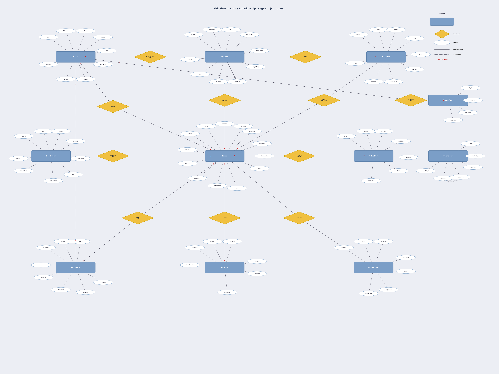

# RideFlow: Ride-Hailing Database System

A ride-hailing back office built around a MySQL schema: riders request rides, drivers accept and
complete them, fares are computed in a stored procedure, and admins manage users, drivers, promo codes,
payments and reports. A Flask API serves three browser portals (admin, rider, driver).

**Stack:** MySQL 8 (triggers, stored procedures, views) · Python · Flask · plain HTML/JS · OpenStreetMap
Nominatim (geocoding) and OSRM (route distance)



## What's implemented

| Module | SQL features |
|---|---|
| User management | INSERT, SELECT, UPDATE; DCL (GRANT/REVOKE) examples |
| Driver management | INSERT, UPDATE, JOINs, payout logic |
| Vehicle management | INSERT, UPDATE, FK constraints |
| Ride management | Ride state machine; completed rides archived to `RideHistory` |
| Fare & pricing | Stored procedure `calculate_fare()` with surge pricing and promo codes |
| Payments | INSERT, UPDATE (refunds), driver commission |
| Promo codes | INSERT, SELECT with date validation |
| Ratings | INSERT fires the `flag_low_rated_driver` trigger |
| Reports | GROUP BY with SUM / COUNT / AVG |
| Leaderboard | View `DriverLeaderboard`: top-rated verified drivers by city |
| Admin flags | Populated automatically by the trigger |

**Schema:** Users, Drivers, Vehicles, Rides, RideHistory, FarePricing, PromoCodes, Payments, Ratings,
AdminFlags. All DDL is in `SCHEMA` in `app.py` and is applied by `setup()`.

## Setup

Requires MySQL 8 and Python 3.10+. The MySQL user needs permission to create a database.

```bash
pip install -r requirements.txt
```

Set the connection through environment variables (PowerShell shown; defaults in brackets):

```powershell
$env:RIDEFLOW_DB_HOST = "localhost"      # [localhost]
$env:RIDEFLOW_DB_PORT = "3306"           # [3306]
$env:RIDEFLOW_DB_USER = "root"           # [root]
$env:RIDEFLOW_DB_PASSWORD = "<your MySQL password>"
python app.py
```

The server starts at http://localhost:5000 and creates the `rideflow_db` schema on startup. It can
also be re-created from the admin panel's **Setup DB** tab.

| Page | URL |
|---|---|
| Sign in / sign up | http://localhost:5000/index.html |
| Admin panel | http://localhost:5000/admin |
| Rider portal | http://localhost:5000/rider |
| Driver portal | http://localhost:5000/driver |

Set `FLASK_DEBUG=1` to run Flask in debug mode.

## Changes since the course submission

- Database credentials are read from environment variables instead of being written in `app.py`.
- Passwords are stored as salted hashes (Werkzeug `generate_password_hash` / `check_password_hash`)
  instead of plain text. Accounts created with the original version won't log in; re-create them.
- Flask's static folder is disabled, so the server no longer serves source files.

## Limitations

- There are no sessions or tokens: after login the browser keeps the user id, and the API endpoints
  don't check who is calling. Anyone can sign up as an admin. This is a database course project,
  not a deployable service.
- `setup()` ignores errors for individual DDL statements, so a failed statement is silent.
- Geocoding and routing use the public Nominatim and OSRM demo servers, which are rate-limited.
- No automated tests.

> **Team project.** Database Systems Lab, FAST-NUCES (Spring 2026), by Ibrahim Ghauri and Hamza Sardar Khan.

## Licence

MIT; see `LICENSE`.
